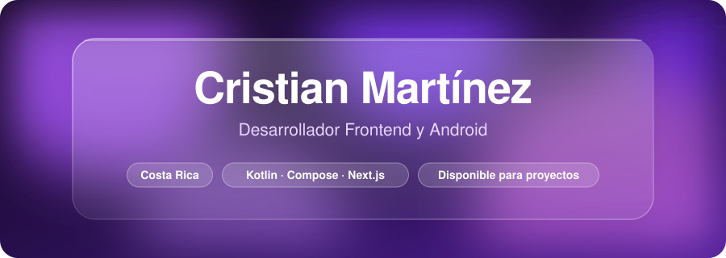
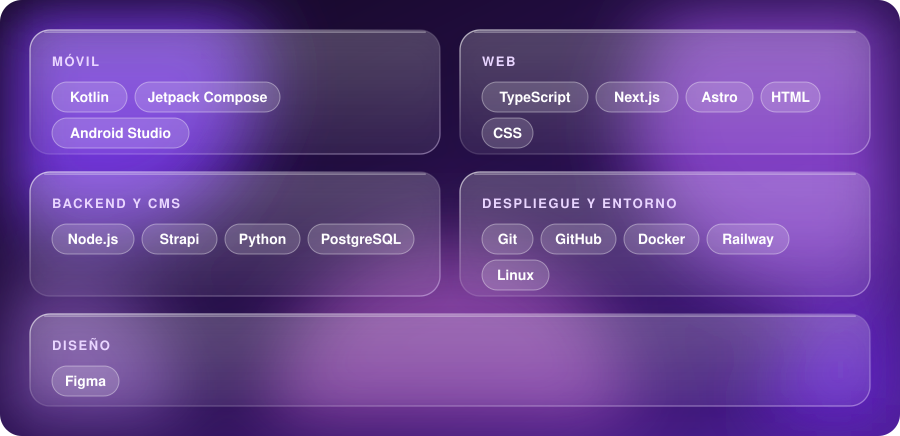
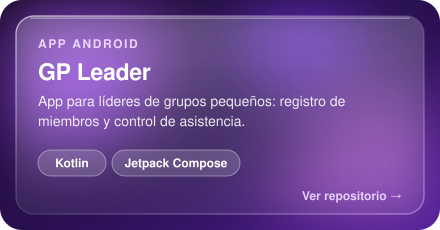
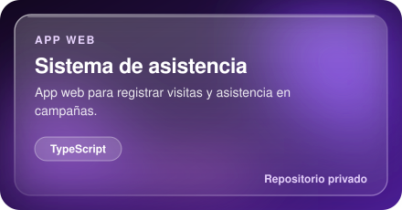
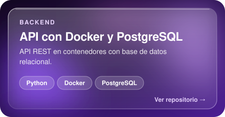
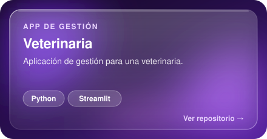

  

  

## 👋 Sobre mí

Soy estudiante de Ingeniería en Sistemas en UNADECA, con énfasis en **desarrollo frontend y experiencia de usuario (UX)**. Ya trabajo con clientes reales: llevo los proyectos desde la idea y el diseño hasta que están publicados y funcionando.

- 📱 Desarrollo aplicaciones Android nativas con **Kotlin** y **Jetpack Compose**
- 🌐 Construyo sitios web modernos con **Next.js**, **Astro** y **TypeScript**
- 🎨 Diseño interfaces pensando primero en quien las va a usar
- 🚀 Me encargo del despliegue, el CMS y el mantenimiento

## 🛠️ Herramientas

  

## 🚀 Proyectos destacados

  
  

  
  

## 📫 Contacto

  

